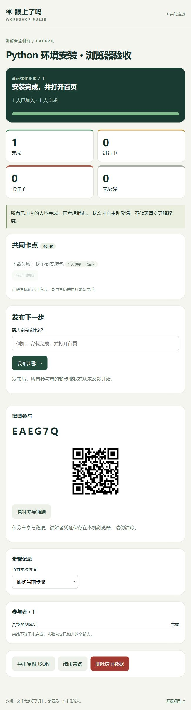

# 跟上了吗 · Workshop Pulse

[](LICENSE)

让操作教学的每一步都有回应。适用于软件培训、实验带练和远程安装指导。

讲解者发布“安装完成，并打开首页”，参与者扫码后点击 **进行中 / 完成 / 卡住了**。面板单独显示未反馈、优先呈现共同卡点，历史步骤保持独立。无需注册，不接 AI，不接 PPT。



## 启动

Python 3.10+：

```sh
python -m venv .venv
# Windows PowerShell
.venv/Scripts/python -m pip install -r requirements.txt -c requirements-lock.txt
.venv/Scripts/python -m uvicorn app:app --host 0.0.0.0 --port 8000
# macOS / Linux 改用 .venv/bin/python
```

浏览器访问 http://localhost:8000 。创建房间后，主持凭证保存在当前浏览器；用另一浏览器或手机打开参与链接测试。手机与电脑需在同一网络，使用电脑的局域网 IP，例如 `http://192.168.1.20:8000`，并允许防火墙入站 TCP 8000。用局域网 IP 打开主持页面，二维码就会编码这个地址，不能让手机扫描 localhost。

Docker：

```sh
# .env 设置为参与者实际可访问的地址；不设置时默认 localhost
# PUBLIC_URL=https://workshop.example.com
docker compose up -d --build
```

只有源码托管在 GitHub；GitHub Pages 无法运行此后端。Docker 将 SQLite 保存在命名卷 `workshop-data`，不要使用 `docker compose down -v`，除非确实要销毁数据。

## 使用

1. 创建房间并发布第一步；分享参与链接/二维码，勿清除主持浏览器数据。
2. 参与者输入昵称；昵称仅讲解者可见，其他参与者只能看汇总。
3. 每步选择状态。提交卡点或点击“我也一样”会同步标记卡住；每人每个卡点只计一次。
4. 讲解者标记卡点已回应，参与者自行确认是否完成。回应不是自动完成，卡点累计赞同数也不是当前受阻人数。
5. 发布下一步；所有已加入者从未反馈开始。迟到者会加入房间总人数；历史计数以对应步骤保存的参与范围为准。
6. 结束后仍可查看、导出 JSON；删除操作会级联删除本房间数据。

导出包含昵称、步骤、状态和卡点。卡点票数是累计信号，主动撤回后减少，不与“卡住人数”一一对应。建议公开投屏只展示汇总，留意名单隐私。

## 实现与部署

FastAPI + SQLite（WAL）+ 原生 JavaScript + SSE。无前端构建、无 Redis、无外部数据库。服务每秒读取变化并通过 SSE 推送，断线自动重连；参与者每 15 秒心跳，45 秒未收到心跳显示离线。浏览器后台节流可能使在线状态滞后。

仅运行一个 Uvicorn worker。定位为单次小班带练，每房间最多 200 个加入身份；该数字是硬限制，不是性能承诺。浏览器多标签、清理存储、不同设备都可能影响身份与连接数量。

环境变量：`DATABASE_PATH`（默认 `data/workshop.sqlite3`）、`PUBLIC_URL`（二维码使用的公开根地址）。暂不支持子路径部署。`/health` 为健康检查，`/docs` 为接口文档。所有受保护接口用 Authorization 头传房间凭证；SSE 用 fetch streaming 实现，不将凭证置入 URL。

公网请用 Caddy/Nginx 终止 HTTPS，禁用 `/api/rooms/*/events` 的代理缓冲并将读取超时设为至少 60 秒；配置合适的网关速率限制。只向可信反代开放后端，转发头仅信任反代地址。SQLite 备份建议使用 Python sqlite3 的 backup API；备份含个人数据，按需清理。完整安全边界见 [SECURITY.md](SECURITY.md)。

## 验证与贡献

```sh
python -m pip install -r requirements-dev.txt
python -m pytest -q
node --check static/app.js
```

测试覆盖权限隔离、旧步骤拒写、卡点去重、状态变更、历史范围、关闭与删除、持久化、二维码、10 人并发反馈和 SSE 格式。CI 模板同时构建 Docker 镜像。当前发布凭证缺少 GitHub `workflow` scope，因此模板存放在 [docs/ci.yml.example](docs/ci.yml.example)，尚未启用或运行。维护者可在具备工作流权限的环境复制到 `.github/workflows/ci.yml` 后提交启用。本机 Docker 引擎未运行，镜像构建尚未验证。[贡献指南](CONTRIBUTING.md)。

[竞品调研、差异化与 10 人试用方案](docs/research.md)。本项目没有经过真实课堂验证，不宣称不可替代；不以自动推断代替参与者真实反馈。

MIT License。
