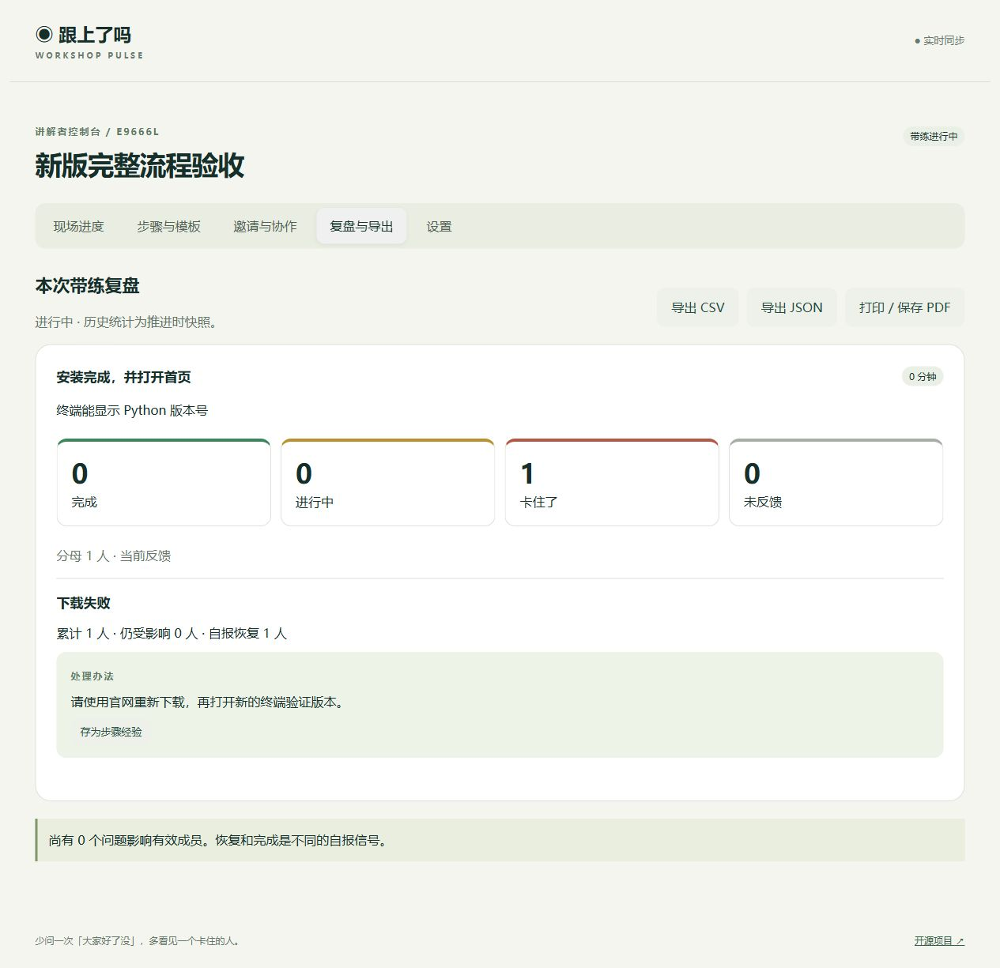

# 跟上了吗 · Workshop Pulse v0.3

免注册、可自部署的操作教学协调工具。讲解者按检查点推进，参与者报告进度，遇到共同问题后接收处理办法并确认恢复。MIT License。



后续目标、优先级与验收标准见 [项目目标清单](docs/roadmap.md)。未勾选项目尚未完成。

## 已实现

- 主持控制台、参与端、助教工作台、匿名投屏四种权限视图。
- 步骤新增、编辑、排序、发布、完成标准、帮助链接和预设原因。
- 模板 JSON 导入导出、复制新场次、Python 环境安装示例、保存有效回答为可复用经验。
- 进行中／完成／卡住了，未反馈单列；预计、有效加入、累计加入、尚差人数分开。
- 卡点赞同、回答、帮助链接、认领／分配、同一步骤合并、参与者恢复或重新报告受阻。
- 推进时冻结历史人数和状态；前序卡点及未完成步骤持续跟进，恢复不改写旧统计。
- 座位号状态图和筛选、离线提示、正式离开与移除、全班公告、倒计时、自愿开启浏览器通知。
- 可撤销的助教和投屏链接；主持及参与者可下载恢复凭证，在首页恢复身份。
- 复盘页、CSV／JSON 导出、浏览器打印／保存 PDF、事件记录、房间删除。
- SQLite 持久化和兼容迁移、写请求幂等与状态版本、按身份区分心跳和反馈限流、SSE 自动重连。

## 启动

Python 3.10+，Node 仅用于 JavaScript 语法检查：

```powershell
python -m venv .venv
.venv/Scripts/python -m pip install -r requirements.txt -c requirements-lock.txt
.venv/Scripts/python -m uvicorn app:app --host 0.0.0.0 --port 8000 --workers 1
```

macOS/Linux 改用 `.venv/bin/python`。打开 http://localhost:8000 创建房间。手机须使用电脑局域网 IP（例如 `http://192.168.1.20:8000`），不能扫描 localhost；允许对应防火墙端口。同一浏览器分别保存主持和参与身份。

```sh
# .env 按需设置 PUBLIC_URL=https://workshop.example.com
# 不设置时二维码默认使用当前访问地址；Compose 默认 localhost。
docker compose up -d --build
```

环境变量：`DATABASE_PATH` 默认 `data/workshop.sqlite3`，`PUBLIC_URL` 为二维码使用的根地址。只运行一个 worker；暂不支持子路径。Docker 数据位于命名卷，`down -v` 会销毁卷。

GitHub 仅托管源码，当前没有公网部署。公网应通过 HTTPS 反代，关闭 SSE 缓冲并设置长连接超时。后端只向可信反代开放，配置网关防刷；不能把当前实现当成多租户企业服务。

## 使用流程

创建后先保存主持恢复凭证。进入“步骤与模板”手动编排，或导入示例模板，再发布第一个检查点。在“邀请与协作”分享参与链接，可生成独立助教及只读投屏链接并随时撤销。

参与者可以先点卡住，再选择原因，描述不是反馈的前置条件。讲解者或助教发布办法，参与者选择已解决或仍受阻。恢复最后一个卡点后，本步从卡住回到进行中；只有参与者主动点完成才算完成。累计遇到人数不等于当前受影响人数；退出某卡点会移除该条赞同记录。

推进时仍未完成的人进入前序跟进列表。具体卡点恢复与“已能继续跟上”分别确认，历史统计不变。离线不是离开，正式离开才从当前有效人数中移出。座位图按填写的座位号排序，不是自动探测教室位置。

结束后在“复盘与导出”保存结果；步骤模板与新场次不带走身份或旧求助记录。只有手动保存进步骤提示的处理经验随模板复用。

## 权限与通知

投屏接口在服务端过滤昵称、原始自由文本卡点、私密回答和管理信息，仅展示汇总及明确标为公开的回答。助教可处理问题，不能发布步骤、删除房间、发放权限或替参与者报告完成。

协作链接的凭证位于 URL fragment，页面读取后移除；仍需私下分享。恢复凭证相当于房间钥匙，请单独保管。没有旧凭证不能仅凭同名恢复身份。参与者其他同伴可看共同卡点和回答，不可看名单。

浏览器通知默认关闭，须主动授权，通常需要 HTTPS 或 localhost；网页关闭后不发送后台通知。公告和明确公开的回答会显示到投屏，请勿写入个人敏感信息。计时结束不会自动推进。

## 验证与限制

```sh
python -m pip install -r requirements-dev.txt -c requirements-lock.txt
python -m pytest -q
node --check static/app.js
```

本次 25 项测试通过，覆盖权限隔离、撤销、模板、复制、合并去重、恢复、人数冻结、版本冲突、幂等、旧库迁移与备份、60 身份同出口的心跳及反馈。浏览器已验证创建、步骤编排发布、卡点提交、回答与恢复、复盘入口。

60 身份测试是本机短程接口测试，不是 30 分钟持续负载、真实设备或课堂容量证明。系统通知、多种手机浏览器、弱网长时运行和真实课堂效果仍需实测。当前 Docker 引擎状态未完成验证，镜像构建/运行未验证。GitHub 凭证缺少 workflow 权限，CI 配置仍以 [模板](docs/ci.yml.example) 提供，未启用，不能视作 CI 通过。

[升级与回退](docs/upgrade-v030.md) · [研究与设计依据](docs/next-version-research.md) · [安全边界](SECURITY.md) · [贡献指南](CONTRIBUTING.md)
